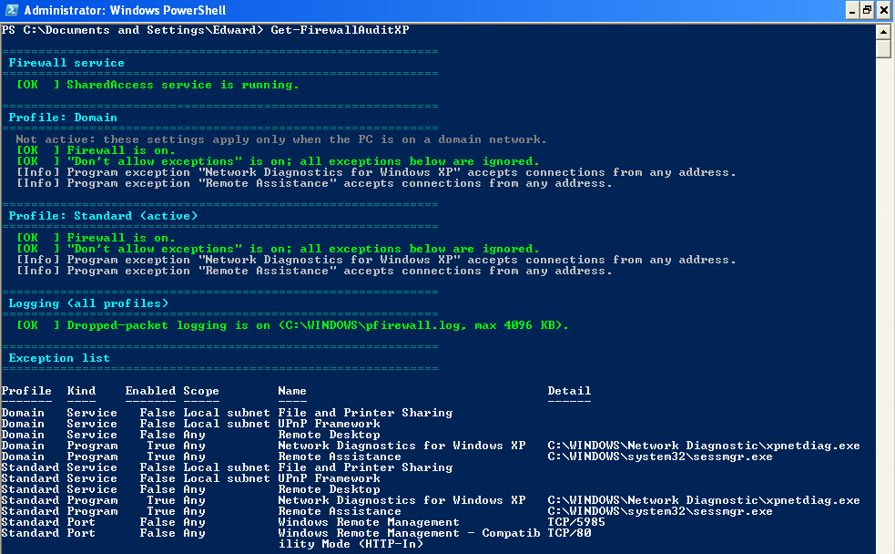
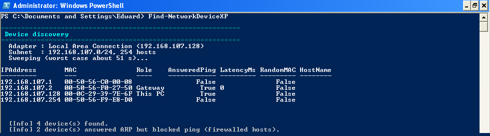
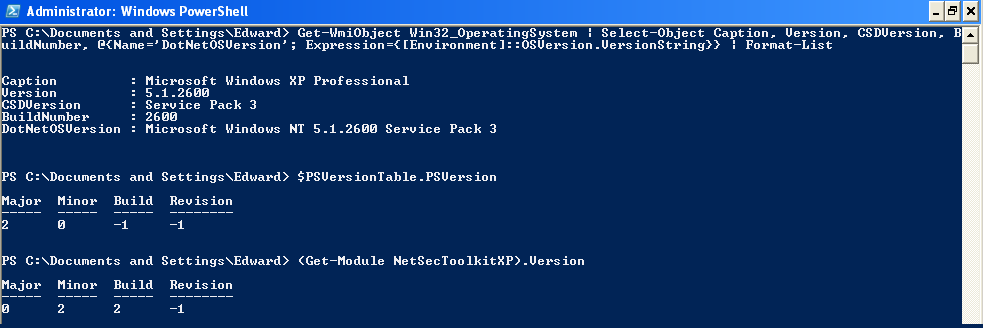
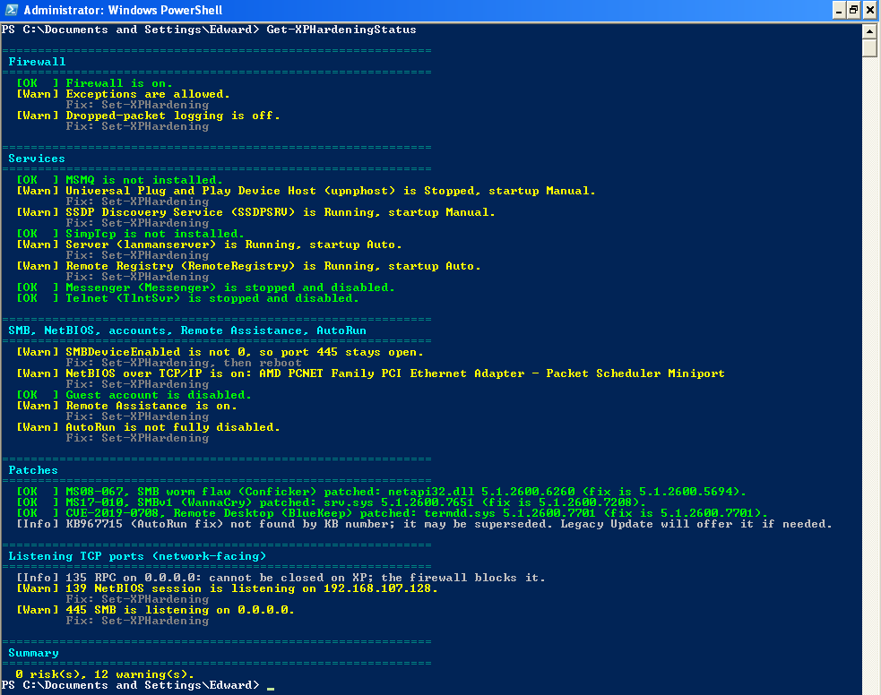
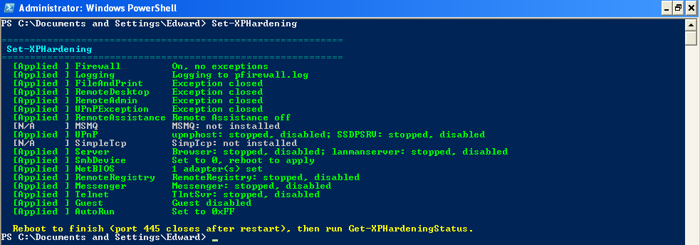
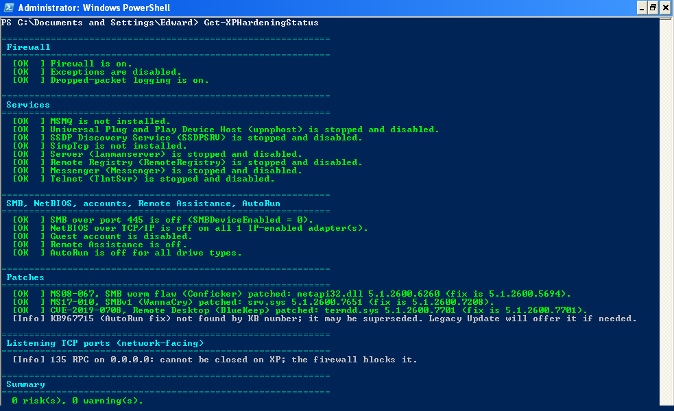
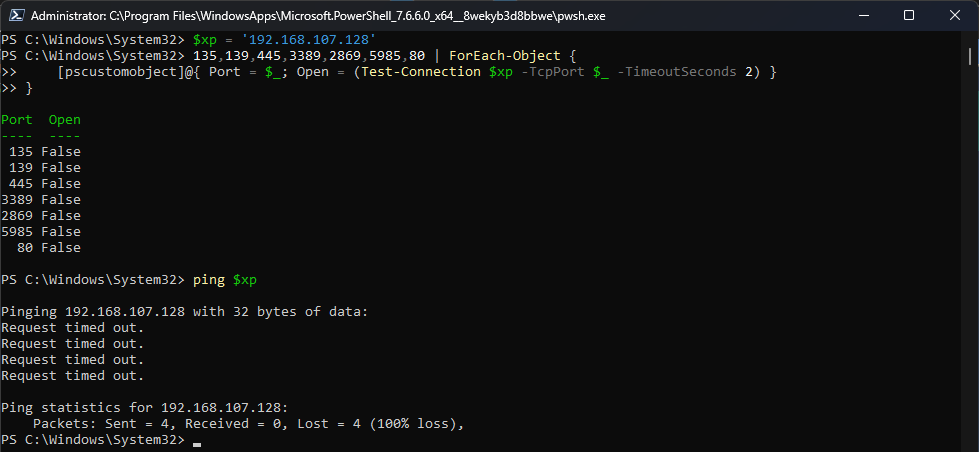
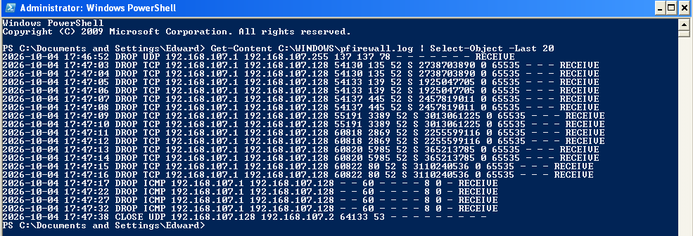
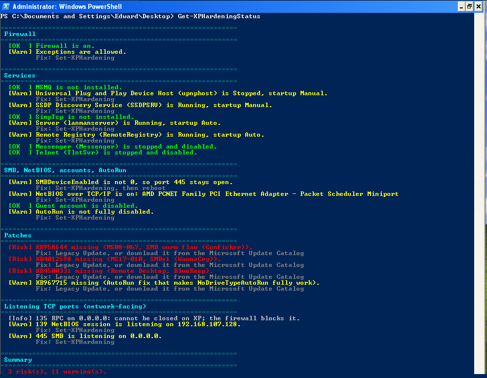

# NetSecToolkitXP

  

The Windows XP SP3 / PowerShell 2.0 edition of my [PowerShell Network Security Toolkit](https://github.com/EdwardOconnell/powershell-network-security-toolkit).

The main toolkit targets PowerShell 7 and relies on the `Net*` cmdlets (`Get-NetAdapter`, `Get-NetFirewallRule`), which only exist on Windows 8 and later. This edition rebuilds the core checks with WMI, COM and `netsh firewall` so they run on XP. It also adds a one-command hardening baseline based on locking down a real XP laptop, an all-in-one daily check, and a security assistant that explains the findings and says what to fix first.

Everything is read-only except `Set-XPHardening` (which supports `-WhatIf`) and `Set-XPAssistantConfig` (which only saves the assistant's settings).

## Commands

| Command | What it does |
|---|---|
| `Get-NetAdapterHealthXP` | Adapters from WMI: IP, mask, gateway, DNS, DHCP lease, NetBIOS. Flags APIPA addresses, missing gateway/DNS and NetBIOS. Pings the gateway and 8.8.8.8 and tests DNS. |
| `Get-FirewallAuditXP` | Audits Windows Firewall through the `HNetCfg.FwMgr` COM API: service state, Domain and Standard profiles, service/program/port exceptions and ICMP, plus logging from `netsh firewall show logging`. Prints `netsh` fixes. |
| `Find-NetworkDeviceXP` | Ping sweep of the local subnet plus `arp -a`, so devices that block ping still show up. Marks the gateway, this PC and randomized MACs. |
| `Set-XPHardening` | Applies the hardening baseline in one run (details below). Supports `-WhatIf`, `-Confirm` and `-Skip`. |
| `Get-XPHardeningStatus` | Read-only check of the baseline, logon security (anonymous access, LM hashes, NTLMv2, password and lockout policy, DEP), the wormable-flaw patches, and which TCP ports are listening on the network. Ends with a risk/warning count. |
| `Get-AccountAuditXP` | Local accounts and who is in Administrators. Flags accounts allowed a blank password, enabled support accounts, blank-password network logons, automatic logon (and a plain-text `DefaultPassword` in the registry) and a screen saver with no password. |
| `Get-FirewallLogXP` | Summarizes `pfirewall.log`: how much was blocked, which addresses tried to reach this PC, likely port scans, and blocked traffic from the internet or from outside the subnet. |
| `Test-RouterExposureXP` | Checks 16 common TCP ports on the router from inside the network and whether it answers UPnP discovery. |
| `Get-USBHistoryXP` | Every USB storage device ever connected (model and serial, from `USBSTOR`), and whether USB storage is blocked. |
| `Invoke-XPSecurityCheck` | Runs all of the checks above in one go, flags devices and USB drives that are new since the last run, and saves a transcript, an HTML report and a snapshot. |
| `Invoke-XPAssistant` (alias `xpai`) | Security assistant: explains findings, answers questions and builds a fix order. Works offline; can also ask Claude through a relay on a modern PC. See [Security assistant](#security-assistant). |
| `Set-XPAssistantConfig` | Saves the relay address and token for the assistant's Claude mode. |

The checks accept `-PassThru` to return objects, and `Get-Help <command> -Full` shows the built-in help.

The repo also has `relay\Start-ClaudeRelay.ps1`, which runs on the modern host PC (PowerShell 7), not on XP. It is only needed for the assistant's Claude mode.

## Requirements

- Windows XP SP3 (Professional recommended; see [Known limits](#known-limits))
- .NET Framework 2.0 SP1 or later (3.5 SP1 covers it)
- Windows PowerShell 2.0, from the Windows Management Framework Core package (KB968930)

## Install

1. Download the repo and copy the `NetSecToolkitXP` folder to the XP machine, for example:
   `C:\Documents and Settings\<you>\My Documents\WindowsPowerShell\Modules\NetSecToolkitXP`
2. If you downloaded it with a browser on XP, right-click each file, choose **Properties**, and click **Unblock**. PS 2.0 has no `Unblock-File`.
3. Allow local scripts, once:
   ```powershell
   Set-ExecutionPolicy RemoteSigned -Scope CurrentUser
   ```
   Or for one session only: `powershell -ExecutionPolicy Bypass`
4. Import the module:
   ```powershell
   Import-Module NetSecToolkitXP
   ```
   Or by path, from anywhere: `Import-Module C:\path\to\NetSecToolkitXP\NetSecToolkitXP.psd1`

### Load it in every new window (optional)

PowerShell 2.0 doesn't load modules automatically, so each new window needs `Import-Module` first. To have it load every time, add the import to your profile once:

```powershell
New-Item -ItemType File -Path $PROFILE -Force
Add-Content -Path $PROFILE -Value "Import-Module 'C:\path\to\NetSecToolkitXP\NetSecToolkitXP.psd1'"
```

## Usage

### `Get-NetAdapterHealthXP`

Shows each IP-enabled adapter's status, MAC, IPv4 address and mask, gateway, DNS servers, DHCP lease and NetBIOS setting, then tests connectivity: it pings the gateway and 8.8.8.8 and resolves `www.microsoft.com`.

```powershell
Get-NetAdapterHealthXP
```

It flags APIPA addresses (169.254.x.x, meaning DHCP failed), missing gateway or DNS, and NetBIOS over TCP/IP being on.

### `Get-FirewallAuditXP`

Read-only audit of Windows Firewall. It checks the firewall service, both profiles (Domain and Standard), service/program/port exceptions, ICMP and logging, and prints the `netsh` command to fix anything it flags.

```powershell
Get-FirewallAuditXP
Get-FirewallAuditXP -ExportPath C:\fw-exceptions.csv   # also save the exception list
```

Findings on the Domain profile are reported as Info unless the PC is actually on a domain network.



### `Find-NetworkDeviceXP`

Finds devices on the local subnet. It pings every address (one at a time; a /24 takes under a minute), then reads the ARP table, so devices that block ping still show up.

```powershell
Find-NetworkDeviceXP                                    # default sweep
Find-NetworkDeviceXP -ResolveNames                      # add hostnames (slower)
Find-NetworkDeviceXP -NoSweep                           # only read the current ARP table
Find-NetworkDeviceXP -TimeoutMs 500                     # longer ping timeout for slow networks
Find-NetworkDeviceXP -ExportPath C:\devices.csv         # also save the list
```

Output columns: IP, MAC, role (gateway / this PC), whether it answered ping, latency, and whether the MAC is randomized (common on phones). Subnets larger than /22 are capped to the local /24.



### `Get-XPHardeningStatus`

Read-only check of the full baseline: firewall and logging, services, SMB/NetBIOS, Guest account, Remote Assistance, AutoRun, logon security (RestrictAnonymous, NoLMHash, LmCompatibilityLevel, password length, lockout, DEP), the three wormable-flaw fixes (checked by file version) and network-facing TCP ports. Ends with a risk/warning count.

```powershell
Get-XPHardeningStatus
```

### `Get-AccountAuditXP`

Lists the local accounts (enabled, admin, password required, locked out, built-in) and flags:

- enabled accounts allowed a blank password (`PasswordRequired = False`)
- enabled `HelpAssistant` / `SUPPORT_388945a0` accounts
- `LimitBlankPasswordUse = 0` (blank-password accounts can log on over the network)
- automatic logon, and a **plain-text password** in `Winlogon\DefaultPassword` (it never prints the password)
- a screen saver that doesn't ask for a password

```powershell
Get-AccountAuditXP
```

### `Get-FirewallLogXP`

Reads `pfirewall.log` (and `pfirewall.log.old` after a rollover) and summarizes blocked traffic by source. It flags one source trying 10+ ports (a likely scan), and blocked traffic from a public internet address that reached this PC directly, which usually means a router port forward or DMZ. Needs the `Logging` step; run it as an administrator if the log can't be read.

```powershell
Get-FirewallLogXP              # last 24 hours
Get-FirewallLogXP -Hours 72
```

Large logs are filtered with plain string checks before any parsing, because PS 2.0 on XP is slow at creating objects.

### `Test-RouterExposureXP`

Connects to 16 common TCP ports on the router (FTP, Telnet, HTTP/HTTPS admin, SMB, PPTP, TR-069 and others), one at a time with a timeout, and sends an SSDP search to see whether the router has UPnP on. Telnet, FTP, PPTP and TR-069 open on the LAN are Risks; an HTTP-only admin page and UPnP are warnings.

```powershell
Test-RouterExposureXP                    # the default gateway
Test-RouterExposureXP -Router 192.168.1.1
```

This is the inside view. For the internet's view, run GRC ShieldsUP from a modern PC or phone on the same network.

### `Get-USBHistoryXP`

Lists every USB disk and CD drive ever connected, from `HKLM\SYSTEM\CurrentControlSet\Enum\USBSTOR`, with serial numbers (and marks devices that have none), and reports whether USB storage is blocked (`USBSTOR Start = 4`).

### `Invoke-XPSecurityCheck`

The all-in-one check, modeled on `Invoke-DailySecurityCheck` in the main toolkit. It runs every check above (device discovery reads the ARP cache only unless you add `-ActiveScan`), then:

- flags **devices that are new** since the last check on the same network (identified by the router's MAC). The saved device list keeps every device seen so far, so a phone that dropped out of the ARP cache isn't reported as new when it comes back.
- flags **USB storage devices** connected since the last check
- prints a summary and the assistant's fix order
- saves `Check_<time>.txt` (transcript), `Report_<time>.html` (opens in IE on XP) and `Snapshot_<time>.xml` to `My Documents\SecurityChecks`

```powershell
Invoke-XPSecurityCheck
Invoke-XPSecurityCheck -ActiveScan -LogHours 72
Invoke-XPSecurityCheck -NoRouter -NoReport
```

It changes no settings.

### `Set-XPHardening`

Applies the baseline. Run it in an Administrator window, preview with `-WhatIf` first, and reboot afterward. See [Hardening a machine](#hardening-a-machine) for the full walkthrough and the list of steps.

```powershell
Set-XPHardening -WhatIf                                  # preview, changes nothing
Set-XPHardening                                          # apply
Set-XPHardening -Confirm                                 # ask before each step
Set-XPHardening -Skip Server,SmbDevice,NetBIOS,FileAndPrint   # keep file sharing
```

It only applies changes on 32-bit Windows XP (version 5.1). On anything else, including XP x64 and Server 2003, it stops with a message; `-WhatIf` still previews, and `-Force` applies anyway at your own risk.

## Security assistant

`Invoke-XPAssistant` (or just `xpai`) explains what the checks found and what to do about it. It picks up the findings from every check you ran in the session, or you can pipe them in or use `-Scan`.

```powershell
Get-XPHardeningStatus
xpai                                        # interactive prompt
xpai -Scan                                  # run the status and account checks first
xpai "what is netbios"                      # one question
Get-XPHardeningStatus -PassThru | Invoke-XPAssistant -Question plan
```

At the `XP-AI>` prompt:

| Type | Gets you |
|---|---|
| `summary` | Risk/warning counts and the top risks |
| `plan` | What to fix first, in order, with the commands. Risks that need their own fix come first, then one `Set-XPHardening` run for everything it covers, then the rest. |
| `list` / `explain <n>` | Numbered issues / what issue *n* means and how to fix it |
| `scan` | Runs `Get-XPHardeningStatus` and `Get-AccountAuditXP` and reloads |
| `topics` | Everything the offline notes cover (42 topics) |
| any question | "why turn off smb", "what is 445", "how do I undo the hardening", "is xp safe online" |

### Offline mode (default)

Answers come from notes built into the module, covering every finding the toolkit can produce, XP's wormable flaws, NTLM and LM hashes, DEP, the router, USB, undoing a step, and more. Each answer also lists the matching findings on this PC. Nothing leaves the machine, and it needs no internet.

### Claude mode (optional)

Claude mode sends your question and the loaded findings to Claude for open-ended answers. XP can't make the TLS 1.2 connections the Claude API requires, so a small relay runs on a modern PC (for a VM, the host) and makes the HTTPS call for it:

```
XP VM  --plain HTTP, VM network, relay token-->  Start-ClaudeRelay.ps1 (Windows 11, PowerShell 7)  --HTTPS-->  Claude API
```

**On the host** (PowerShell 7). This needs an Anthropic API key from console.anthropic.com, and usage is billed to that account:

```powershell
$env:ANTHROPIC_API_KEY = 'sk-ant-...'
.\relay\Start-ClaudeRelay.ps1 -AllowedClient 192.168.107.128    # the XP VM's address
```

It listens on the VMware VMnet1/VMnet8 host adapter (or `-ListenAddress`), and prints a token and the exact command to run on XP. If XP can't connect, the relay also prints a Windows Firewall rule scoped to that adapter.

**On XP:**

```powershell
Set-XPAssistantConfig -RelayUrl http://192.168.107.1:8787 -RelayToken <token> -DefaultMode Claude -Test
xpai
```

Type `mode offline` / `mode claude` to switch at the prompt. If the relay can't be reached, the assistant says so and answers from the offline notes.

How the relay is locked down:

- **The API key stays on the host.** XP only stores the relay token, in `%APPDATA%\NetSecToolkitXP`.
- **It only accepts the assistant's request format.** Every request needs the token, and the relay sets its own system prompt (XP-safe commands only, plain ASCII for the XP console), caps the reply length and limits requests to 64 KB, so it isn't an open Claude proxy.
- **It is restricted.** It refuses `0.0.0.0` unless `-AllowAnyAddress` is given, can be limited to the VM's address (`-AllowedClient`), and has a rate limit (`-MaxAsksPer10Min`, default 30).
- **Less personal data goes out.** MAC addresses, the PC name and your user name are masked before anything is sent; `-NoRedact` turns that off.
- **The XP-to-relay hop is plain HTTP.** Keep it on a host-only or NAT VM network.

## Hardening a machine

Run these in an **Administrator** PowerShell window:

```powershell
Get-XPHardeningStatus     # before
Set-XPHardening -WhatIf   # preview, changes nothing
Set-XPHardening
Restart-Computer
Get-XPHardeningStatus     # after
```

Then run Legacy Update and check the patches again with `Get-XPHardeningStatus`.

### What `Set-XPHardening` changes

| Step | Change | Closes |
|---|---|---|
| `Firewall` | Firewall on, exceptions disabled, all profiles | All inbound exceptions |
| `Logging` | Logs dropped packets and connections to `%windir%\pfirewall.log` | |
| `FileAndPrint`, `RemoteDesktop`, `RemoteAdmin`, `UPnPException` | Firewall service exceptions closed | 139, 445, 3389, 135, 2869, 1900 |
| `MSMQ` | Message Queuing stopped and disabled | 1801, 2103, 2105, 2107, 3527 |
| `UPnP` | UPnP Device Host and SSDP Discovery stopped and disabled | 2869, 1900 |
| `SimpleTcp` | Simple TCP/IP Services stopped and disabled | 7, 9, 13, 17, 19 |
| `Server` | Server and Computer Browser stopped and disabled | File sharing |
| `SmbDevice` | `SMBDeviceEnabled = 0` (applies after a reboot) | 445 |
| `NetBIOS` | NetBIOS over TCP/IP off on every network interface, including disabled or unplugged adapters | 137-139 |
| `RemoteAssistance` | Remote Assistance off (`fAllowToGetHelp = 0`) and its `sessmgr.exe` firewall exception disabled | |
| `RemoteRegistry`, `Messenger`, `Telnet` | Stopped and disabled | |
| `Guest` | Built-in Guest account disabled, found by its SID so a renamed Guest is covered | |
| `RestrictAnonymous` | `RestrictAnonymous = 1`, `RestrictAnonymousSAM = 1`: no anonymous (null session) listing of shares and accounts (applies after a reboot) | |
| `NoLMHash` | `NoLMHash = 1`: stop storing crackable LM password hashes (old ones clear at each next password change) | |
| `NTLMv2` | `LmCompatibilityLevel = 3`: send NTLMv2 only (XP default is 0) | |
| `PasswordPolicy` | `net accounts`: minimum 8 characters, lock out for 30 minutes after 10 bad tries | |
| `AutoRun` | `NoDriveTypeAutoRun = 0xFF` | |

Each step reports **Applied**, **N/A** (not installed), **Skipped** or **Failed**, and a failed step doesn't stop the rest.

To keep file sharing working, skip those steps:

```powershell
Set-XPHardening -Skip Server,SmbDevice,NetBIOS,FileAndPrint
```

### Side effects

The PC can no longer share files or printers, open other PCs' shares (`\\PC\share`), accept Remote Desktop, or host LAN games. Browsing, downloads and Windows Update are outbound, so they keep working.

- **NTLMv2 step:** connections to Windows 9x or very old NAS shares stop working. Use `-Skip NTLMv2` if you need them.
- **PasswordPolicy step:** the 8-character minimum applies at each account's next password change. Ten wrong passwords lock an account for 30 minutes; the built-in Administrator is never locked out.

### What it does not cover

- **Patches.** Use Legacy Update or the Microsoft Update Catalog. `Get-XPHardeningStatus` checks the three wormable flaws by the **file version** each fix installed, not by KB number, because later updates (including POSReady 2009 updates) supersede the original KBs:

  | Flaw | File | Fixed in | Original KB |
  |---|---|---|---|
  | MS08-067 (Conficker) | `netapi32.dll` | 5.1.2600.5694 | KB958644 |
  | MS17-010 (WannaCry) | `drivers\srv.sys` | 5.1.2600.7208 | KB4012598 |
  | CVE-2019-0708 (BlueKeep) | `drivers\termdd.sys` | 5.1.2600.7701 | KB4500331 (Update Catalog only) |
- The Administrator password and a non-admin account for daily use. `Get-AccountAuditXP` points these out but changes nothing.
- **Phishing.** Closing inbound ports doesn't stop a user from clicking a malicious link. XP's browsers are long unsupported, so keep browsing to a minimum.

## Case study: Dell Inspiron 1521

These steps were first done by hand on an XP SP3 laptop, then collected into `Set-XPHardening`.

**Before:** the firewall was on but allowed exceptions. `netsh firewall show state` listed open ports for MSMQ (135, 1801, 2103, 2105, 2107, 1026, 1027, 3527), UPnP (2869, 1900), Windows peer-to-peer networking (3540, 3587) and Teredo (3544). `netstat` also showed Simple TCP/IP Services on 7, 9, 13, 17 and 19, plus SMB on 445 and NetBIOS on 139. Only 8 updates were installed, and all three wormable-flaw patches were missing.

**After:** the firewall reported *"No ports are currently open on all network interfaces."* `netstat` listening ports went from 15+ down to RPC on 135 (which can't be closed on XP, and the firewall blocks it) and localhost-only listeners. At the time of writing, 445 was waiting on its reboot.

<!-- Add before/after photos or screenshots of netsh firewall show state and netstat here -->

## Verified on an XP VM

Tested with 0.2.2 on Windows XP Professional SP3 in VMware Workstation (PowerShell 2.0, fully updated through Legacy Update plus KB4500331), starting from a pre-hardening snapshot:




| | Before | After `Set-XPHardening` + reboot |
|---|---|---|
| `Get-XPHardeningStatus` | 0 risks, 12 warnings | **0 risks, 0 warnings** |
| Firewall | On, exceptions allowed, logging off | On, exceptions disabled, logging on |
| Remote Assistance | On | Off |
| Network-facing TCP ports | 135, 139, 445 | **135 only** (RPC, blocked by the firewall) |

`Set-XPHardening` reported 16 steps Applied, 2 N/A (MSMQ and Simple TCP/IP Services weren't installed on the VM) and 0 Failed. All five commands ran without errors, including the 0.2.2 fixes: the firewall audit reads logging correctly and its tables fit the console, and `Find-NetworkDeviceXP` reports the gateway's MAC.

**Before:** `Get-XPHardeningStatus` on the unhardened VM, 0 risks and 12 warnings.



**Hardening:** `Set-XPHardening`, 16 steps Applied, 2 N/A, 0 Failed.



**After the reboot:** 0 risks, 0 warnings, only port 135 listening.



## External verification

`Get-XPHardeningStatus` checks the VM from the inside. To confirm the firewall actually blocks traffic, the hardened VM was also probed from the Windows 11 host over VMware's NAT network (host `192.168.107.1`, VM `192.168.107.128`), using PowerShell 7:

```powershell
$xp = '192.168.107.128'
135,139,445,3389,2869,5985,80 | ForEach-Object {
    [pscustomobject]@{ Port = $_; Open = (Test-Connection $xp -TcpPort $_ -TimeoutSeconds 2) }
}
ping $xp
```

| Port | Service | Reachable from the host |
|---|---|---|
| 135 | RPC (still listening on the VM) | No |
| 139 | NetBIOS session | No |
| 445 | SMB | No |
| 3389 | Remote Desktop | No |
| 2869 | UPnP | No |
| 5985, 80 | Windows Remote Management | No |
| ICMP | Ping | No (100% loss) |

Port 135 is the key result: XP is still listening on it, so the block comes from the firewall, not from the service being off.



An all-blocked result would look the same if the VM were simply unreachable, so the XP firewall log (`C:\WINDOWS\pfirewall.log`, enabled by the `Logging` step) was checked to confirm the probes arrived and were dropped:

```
2026-10-04 17:47:03 DROP TCP 192.168.107.1 192.168.107.128 54130 135 52 S 2738703890 0 65535 - - - RECEIVE
2026-10-04 17:47:05 DROP TCP 192.168.107.1 192.168.107.128 54133 139 52 S 1925047705 0 65535 - - - RECEIVE
2026-10-04 17:47:07 DROP TCP 192.168.107.1 192.168.107.128 54137 445 52 S 2457819011 0 65535 - - - RECEIVE
2026-10-04 17:47:09 DROP TCP 192.168.107.1 192.168.107.128 55191 3389 52 S 3013061225 0 65535 - - - RECEIVE
2026-10-04 17:47:17 DROP ICMP 192.168.107.1 192.168.107.128 - - 60 - - - - 8 0 - RECEIVE
2026-10-04 17:47:38 CLOSE UDP 192.168.107.128 192.168.107.2 64133 53 - - - - - - - - -
```

- `DROP TCP ... S`: a dropped connection attempt (`S` is the TCP SYN flag). Each port appears twice in the full log because the host retried once.
- `DROP ICMP ... 8 0`: a dropped ping (ICMP type 8, code 0 is an echo request).
- `CLOSE UDP ... 53`: the VM's own outbound DNS lookup completing normally, showing outbound traffic still works and is logged.



<!-- Control test: revert to the pre-hardening snapshot and run the same probe; add the before/after results here -->

## Testing

- Parsed with the PowerShell language parser, plus a scan for PowerShell 3.0+ syntax: `[pscustomobject]`, `[ordered]`, `-in`, simplified `Where-Object`, `-Parallel`, PS3+ parameters.
- Every command exercised in PowerShell 7 against mocked WMI, COM, `netsh`, ARP and registry data, including the `-WhatIf`, `-Skip`, failed-step and already-applied paths.
- Real runs on an XP Professional SP3 VM: see [Verified on an XP VM](#verified-on-an-xp-vm) and [External verification](#external-verification). Each round of VM testing found real bugs that mocks missed: a false positive in the original KB-number patch check (fixed in 0.2.1), and a wrong logging check, a missing gateway MAC and wrapped tables (fixed in 0.2.2).
- **0.2.3 came from a code review**, and each fix was checked against mocks that reproduce the bug on 0.2.2 first. Those fixes have not had their XP VM run yet; the VM results above are from 0.2.2.

  The very first real run (0.2.0) reported three wormable-flaw patches as missing on a fully patched VM. Later POSReady updates had replaced the original KBs, so the check now compares file versions instead:

  
- **0.3.0** was tested the same way, against mocked data on PowerShell 7:
  - **Every new command:** account audit, firewall log, router, USB, two runs of `Invoke-XPSecurityCheck` (new device and new USB drive flagged on the second), and the assistant's offline answers and interactive prompt.
  - **Claude mode, end to end:** the XP client through `Start-ClaudeRelay.ps1` to a fake Messages API. That covered multi-turn history, masking, and the wrong-token (401), oversized (413), rate-limit (429), blocked-client (403) and relay-down paths.
  - **An independent code review** focused on PS 2.0 / .NET 2.0 compatibility, which found no runtime breakers and 15 smaller fixes, all applied.
  - **Not yet:** it hasn't had its XP VM run, and Claude mode hasn't been run against the live API. The VM results above are from 0.2.2.
- Files are pure ASCII with CRLF line endings, so PS 2.0 reads them correctly and they open cleanly in XP's Notepad.
- Recommended: test in an XP SP3 VM using **NAT or Host-only networking** (never Bridged), with a snapshot taken before running `Set-XPHardening`.

## Known limits

- Built for **32-bit XP SP3**. Remote Desktop and Remote Admin exceptions don't exist on XP Home, so those steps report Failed there. Use `-Skip RemoteDesktop,RemoteAdmin`.
- **XP x64 and Server 2003** (version 5.2) are not supported: `Set-XPHardening` refuses without `-Force`, and `Get-XPHardeningStatus` skips the wormable-flaw checks there, because their file versions (5.2.3790.x) would always look newer than the XP fixes.
- **Vista and 7 are not supported yet.** They use Windows Firewall with Advanced Security (`MpsSvc` and `netsh advfirewall`), different patch KB numbers, and a different SMB stack.
- `netsh`, `arp -a`, `net accounts` and `net localgroup` parsing expects English-language XP output.
- `Test-RouterExposureXP` checks one port at a time (PS 2.0 has no `-Parallel`), about 13 seconds worst case. A router that ignores SSDP from this PC shows UPnP as off.
- Claude mode needs a modern PC running the relay and an Anthropic API key; the offline assistant needs neither.
- Firewall logging is a single setting for all profiles on XP, read from `netsh firewall show logging`.
- DHCP lease times use `System.Management`; if one shows blank, `ipconfig /all` has it.

## Roadmap

- `Set-XPHardening` run on the physical XP laptop, with results added above
- Vista / 7 support: OS detection, `advfirewall` commands, per-OS patch IDs
- 0.3.0 run on the XP VM, with screenshots of the new commands

## Changelog

- **0.3.0** (new features and the assistant):
  - **Security assistant:** `Invoke-XPAssistant` (alias `xpai`) with offline notes, finding explanations and a fix order, plus an optional Claude mode through `relay\Start-ClaudeRelay.ps1`. `Set-XPAssistantConfig` saves the relay settings.
  - **New checks:** `Get-AccountAuditXP`, `Get-FirewallLogXP`, `Test-RouterExposureXP` (ports and UPnP) and `Get-USBHistoryXP`.
  - **`Invoke-XPSecurityCheck`:** runs everything, flags new devices and USB drives since the last run, and saves a transcript, an HTML report and a snapshot.
  - **New `Set-XPHardening` steps:** `RestrictAnonymous`, `NoLMHash`, `NTLMv2` and `PasswordPolicy`. `Get-XPHardeningStatus` checks them, plus DEP.
  - **Small changes:** the step column in `Set-XPHardening` output is wider, and the status summary points to the assistant.
- **0.2.3** (code review fixes):
  - **XP x64 / Server 2003 reported as patched when they weren't.** Their 5.2.3790.x file versions always compared newer than the 32-bit XP fix versions, so an unpatched system showed all three wormable flaws as fixed. The patch check now only runs on 32-bit XP, and `Set-XPHardening` refuses other Windows versions unless `-Force` is given.
  - **NetBIOS step reported Failed when Windows said "done, reboot required"** (WMI return code 1), and it skipped adapters that were disabled or not IP-enabled, which turned NetBIOS back on when re-enabled. It now sets every NetBT interface in the registry, and `Get-XPHardeningStatus` checks every interface.
  - **A renamed Guest account was missed.** `Set-XPHardening` failed with "user name could not be found", and `Get-XPHardeningStatus` reported no Guest even while it was enabled. Both now find it by its SID (RID 501), which also works on non-English XP.
  - **Remote Assistance's firewall exception stayed enabled** after the `RemoteAssistance` step. It is now disabled in both profiles, and `Get-XPHardeningStatus` reports it.
  - `Get-XPHardeningStatus` also checks the Computer Browser service, which `Set-XPHardening` disables.
- **0.2.2:** `Set-XPHardening` also turns on firewall logging and turns off Remote Assistance. Logging is now read from `netsh` (the old registry check reported logging off when it was on). Tables fit the console window. `Find-NetworkDeviceXP` re-pings hosts whose ARP entry expired during the sweep, so the gateway's MAC is no longer blank.
- **0.2.1:** Wormable-flaw checks compare file versions instead of KB numbers, so superseding updates count.
- **0.2.0:** Added `Set-XPHardening` and `Get-XPHardeningStatus`.
- **0.1.0:** `Get-NetAdapterHealthXP`, `Get-FirewallAuditXP`, `Find-NetworkDeviceXP`.

## Disclaimer

Use this only on systems you own or are authorized to manage. Windows XP has been unsupported since 2014. Hardening reduces the network attack surface, but it doesn't make XP safe for everyday internet use. Keep XP machines off untrusted networks.
